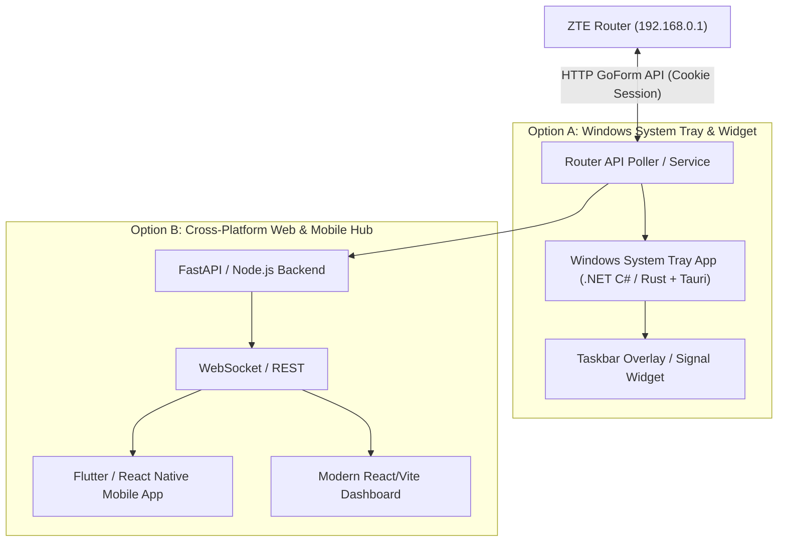

# ZTE MF282 / DreiTube Router API Analysis & App Strategy

## Executive Summary

Using Chrome DevTools analysis on the live router web interface (`http://192.168.0.1`), we successfully analyzed the network traffic, session management, authentication algorithm, and internal HTTP endpoints of the **ZTE MF282 / DreiTube Router** (Software Version `CR_H3GATMF282PLUSV1.0.0B23`).

This document provides exact specifications for intercepting network metrics and building a custom monitoring application (Windows System Tray/Taskbar, Mobile, or Web).

---

## 1. Authentication & Session Management

The router uses a custom GoForm API (`/goform/goform_set_cmd_process`) with SHA256 password hashing and cookie-based session management.

### Password Hashing Formula
The router does **not** transmit plain text passwords. The raw password from `.env` (`ROUTER_PASSWORD=<your-router-password>`) is processed using:

$$\text{password\_hash} = \text{SHA256}\left( \text{Base64Encode}(\text{raw\_password}) \right)$$

1. **Raw Password**: `<your-router-password>`
2. **Base64 Encoded**: `<base64-of-password>`
3. **SHA-256 Hashed (Uppercase Hex)**: `<sha256-hash>`

### Login HTTP Request
* **Endpoint**: `POST http://192.168.0.1/goform/goform_set_cmd_process`
* **Headers**:
  * `Content-Type`: `application/x-www-form-urlencoded; charset=UTF-8`
  * `Origin`: `http://192.168.0.1`
  * `Referer`: `http://192.168.0.1/index.html`
* **Body**:
  ```http
  isTest=false&goformId=LOGIN&password=<sha256-hash>
  ```
* **Response**:
  ```json
  {"result": "0"}
  ```
  *(Result `"0"` indicates successful login)*

* **Session Cookie**:
  The response header sets a session cookie:
  `Set-Cookie: zwsd="<32-character-hex-hash>"; HttpOnly=1`
  All subsequent API requests must include the header `Cookie: zwsd="..."` and `Referer: http://192.168.0.1/index.html`.

---

## 2. API Endpoints & Field Mappings

All telemetry data is fetched via `GET http://192.168.0.1/goform/goform_get_cmd_process`.

### A. Signal Quality Metrics (RSRP, RSRQ, RSSI, Band, CA)

* **Request**:
  ```http
  GET /goform/goform_get_cmd_process?isTest=false&cmd=network_type,rssi,rscp,lte_rsrp,Z_rssi,Z_rscp,Z_rsrp,Z_rsrq,wan_lte_ca,lte_ca_pcell_bandwidth,lte_ca_pcell_band,lte_ca_scell_bandwidth,lte_ca_scell_band,ZCELLINFO_band&multi_data=1&_={timestamp}
  ```

* **Live Sample Response**:
  ```json
  {
    "network_type": "LTE_A",
    "rssi": "-70",
    "rscp": "",
    "lte_rsrp": "-106",
    "Z_rssi": "-70",
    "Z_rscp": "",
    "Z_rsrp": "-106",
    "Z_rsrq": "-17.0",
    "wan_lte_ca": "ca_activated",
    "lte_ca_pcell_bandwidth": "15.0",
    "lte_ca_pcell_band": "3",
    "lte_ca_scell_bandwidth": "20.0",
    "lte_ca_scell_band": "1",
    "ZCELLINFO_band": "LTE B3"
  }
  ```

* **Field Breakdown**:
  | Parameter | Description | Unit / Value |
  | :--- | :--- | :--- |
  | `lte_rsrp` / `Z_rsrp` | **RSRP** (Reference Signal Received Power) | dBm (e.g., `-106` dBm) |
  | `Z_rsrq` | **RSRQ** (Reference Signal Received Quality) | dB (e.g., `-17.0` dB) |
  | `Z_rssi` / `rssi` | **RSSI** (Received Signal Strength Indicator) | dBm (e.g., `-70` dBm) |
  | `network_type` | Network Mode | `LTE_A` (LTE Advanced) / `LTE` |
  | `ZCELLINFO_band` | Active Serving Band | `LTE B3` (1800 MHz) |
  | `wan_lte_ca` | Carrier Aggregation Status | `ca_activated` |
  | `lte_ca_pcell_band` | Primary Cell LTE Band | `3` |
  | `lte_ca_scell_band` | Secondary Cell LTE Band | `1` (2100 MHz) |

---

### B. Download Speed, Upload Speed, Router Uptime & Total Traffic

* **Request**:
  ```http
  GET /goform/goform_get_cmd_process?multi_data=1&isTest=false&sms_received_flag_flag=0&sts_received_flag_flag=0&cmd=modem_main_state,pin_status,opms_wan_mode,loginfo,new_version_state,current_upgrade_state,is_mandatory,wan_ipaddr,static_wan_ipaddr,ipv6_wan_ipaddr,signalbar,network_type,network_provider,ppp_status,EX_SSID1,sta_ip_status,EX_wifi_profile,guest_switch,wifi_ap_mode,SSID1,m_SSID,wifi_onoff_state,wifi_chip1_ssid1_ssid,wifi_chip2_ssid1_ssid,wifi_chip1_ssid1_access_sta_num,wifi_chip2_ssid1_access_sta_num,wifi_chip1_ssid2_access_sta_num,wifi_chip2_ssid2_access_sta_num,wifi_lbd_enable,simcard_roam,lan_ipaddr,wifi_access_sta_num,station_mac,battery_charging,battery_vol_percent,battery_pers,spn_name_data,spn_b1_flag,spn_b2_flag,wifi_chip1_ssid1_switch_onoff,wifi_chip2_ssid1_switch_onoff,realtime_tx_bytes,realtime_rx_bytes,realtime_time,realtime_tx_thrpt,realtime_rx_thrpt,monthly_rx_bytes,monthly_tx_bytes,monthly_time,date_month,data_volume_limit_switch,data_volume_limit_size,data_volume_alert_percent,data_volume_limit_unit,roam_setting_option,upg_roam_switch,ssid,wifi_enable,dial_mode,hmnc,hmcc,mnc,mcc,wlan_process,wifi_dfs_status,privacy_read_flag,wifi_mesh_sta_access_num,wifi_mesh_lan_access_num,wifi_mesh_deployed,wifi_start_mode,wifi_mesh_re_num,wan_lte_ca,pppoe_status,dhcp_wan_status,static_wan_status,sms_received_flag,sts_received_flag,sms_unread_num&_={timestamp}
  ```

* **Live Sample Response Extract**:
  ```json
  {
    "realtime_rx_thrpt": "1557",
    "realtime_tx_thrpt": "2060",
    "realtime_time": "3402",
    "realtime_rx_bytes": "2369121817",
    "realtime_tx_bytes": "114174145",
    "wifi_access_sta_num": "1",
    "wifi_mesh_lan_access_num": "4",
    "signalbar": "2",
    "network_provider": "3 AT",
    "ppp_status": "ppp_connected"
  }
  ```

* **Calculations & Formulas**:
  * **Download Speed**: `realtime_rx_thrpt` Bytes/sec $\times 8 / 1000 = \text{Kbps}$ (or $/ 1024 = \text{KB/s}$)
    * *Example*: $1557 \text{ B/s} = 1.55 \text{ KB/s} \approx 12.45 \text{ Kbps}$
  * **Upload Speed**: `realtime_tx_thrpt` Bytes/sec $\times 8 / 1000 = \text{Kbps}$
    * *Example*: $2060 \text{ B/s} = 2.06 \text{ KB/s} \approx 16.48 \text{ Kbps}$
  * **Uptime Duration**: `realtime_time` seconds
    * *Example*: $3402 \text{ seconds} = \text{00:56:42}$ (56 minutes, 42 seconds)
  * **Downloaded Volume**: `realtime_rx_bytes` Bytes
    * *Example*: $2,369,121,817 \text{ Bytes} \approx 2.37 \text{ GB}$
  * **Uploaded Volume**: `realtime_tx_bytes` Bytes
    * *Example*: $114,174,145 \text{ Bytes} \approx 114 \text{ MB}$

---

### C. Connected Clients List

* **Request**:
  ```http
  GET /goform/goform_get_cmd_process?isTest=false&cmd=lan_station_list&_={timestamp}
  ```

* **Live Sample Response**:
  ```json
  {
    "lan_station_list": [
      {
        "hostname": "Pixel-7",
        "mac_addr": "82:38:34:73:73:71",
        "ip_addr": "192.168.0.4",
        "addr_type": "2"
      },
      {
        "hostname": "deco-X1500",
        "mac_addr": "EC:75:0C:05:26:3C",
        "ip_addr": "192.168.0.2",
        "addr_type": "2"
      }
    ]
  }
  ```

---

## 3. Recommended Application Architecture Options

Depending on your preference for target device/platform, here are the optimal implementation strategies:



### Strategy Comparison Matrix

| Approach | Ideal For | Tech Stack | Pros |
| :--- | :--- | :--- | :--- |
| **Windows Taskbar / System Tray App** | Instant status at a glance while working on PC | C# .NET / Rust + Tauri | Minimal RAM (<20MB), native notifications, lives in taskbar |
| **Mobile App (Android/iOS)** | Checking router health on phone | Flutter or React Native | View signal metrics anywhere in your home Wi-Fi |
| **Web Dashboard / Local Service** | Home lab monitor / Docker container | Node.js / Python + Web UI | Accessible from any browser in local network, history logging |

---

## 4. Implementation Steps

1. **Session Client**: Create an HTTP client that auto-authenticates using `SHA256(Base64(password))` and holds the `zwsd` session cookie.
2. **Polling Loop**: Query signal endpoint (`cmd=network_type,lte_rsrp,Z_rsrq...`) and traffic endpoint every 1–2 seconds.
3. **Re-authentication**: If HTTP 401 or response `loginfo == "logout"`, trigger automatic re-login.
4. **Data Aggregation**: Store historical RSRP/RSRQ and speed graph data for real-time visualization.
